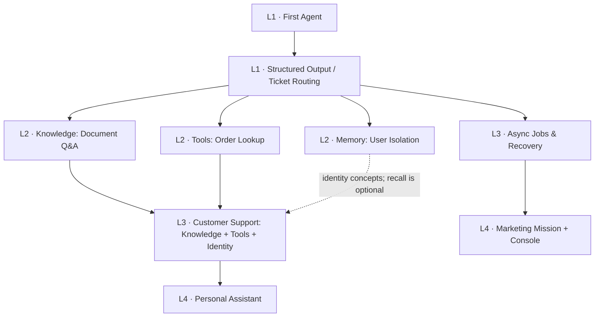

# Learning paths

Choose a learning sequence, a capability, or a complete application. Existing
folders are kept stable; an example can appear in more than one path.

## Learn Step by Step

Start with [local setup](../get-started/README.md) and the
[Python environment/token bridge](recipe-setup.md).

L2 is a set of choices, not three prerequisites to complete in sequence.
Customer Support combines knowledge, tools and identity; cross-conversation
memory is an optional extension. Async Jobs is another independent L3 branch.

| Stage / example | Prerequisites | Observable result | Failure or boundary |
|---|---|---|---|
| L1 [First Agent](../get-started/01-first-agent/) | Working Runtime and token | Create an agent; receive replies with retained conversation context | Invalid credentials; model/service unavailable |
| L1 [Ticket Routing](../recipes/ticket-routing/) | First Agent; Python | Schema-valid intent and measured classification accuracy | Invalid schema is an error; a valid but wrong label is an evaluation miss |
| L2 [Document Q&A](../recipes/document-qa/) | First Agent; knowledge ingestion | Answer backed by the supplied handbook | Missing policy must not be invented |
| L2 [Tools](../recipes/tool-calling/) | First Agent; kernel v0.3.0+; signed callback service | Order status plus a signed callback receipt | Unknown order, invalid signature, unavailable webhook |
| L2 [Memory](../recipes/memory-isolation/) | First Agent; memory enabled; two normal users | A's unique preference is recalled in a new conversation | B cannot recall it, even when requesting A's end-user identity |
| L3 [Customer Support](../recipes/customer-support/) | Knowledge + Tools + trusted identity mapping | KB answer and live order lookup | Tool failure must not become a fabricated order; the bundle registration path needs its documented reload |
| L3 [Async Jobs](../recipes/async-jobs/) | First Agent; PostgreSQL-backed jobs | Job ID survives a client restart; resume reads the same job | Lost response, timeout, failed/cancelled job, authorization error |
| L4 [Personal Assistant](../apps/personal-assistant/) | [Browser sign-in](../get-started/02-sign-in-with-libraos/); Knowledge/Memory | Signed-in conversations, documents and memory | Document/user boundaries and disconnected/error states |
| L4 [Marketing Mission](../apps/digital-marketing-team/) | Native jobs; mission workflow enabled | Attributed final report and runtime events | Replay/reconnection, task failure, pending decision |

Difficulty reflects concepts and operational dependencies, not domain prestige.
Legaltech, healthcare and finance are industry electives; short clinical code
does not imply that clinical outcomes have been validated. Content moderation
is a classification elective with different policy/evaluation requirements.

## Explore by Capability

Choose [Knowledge](../recipes/document-qa/), [Tools](../recipes/tool-calling/),
[Memory](../recipes/memory-isolation/), or [Async](../recipes/async-jobs/) directly.
For approvals, first read [the two mechanisms](approval-mechanisms.md).
Each recipe links to [validation](validation.md); offline tests do not establish
Runtime authorization, retrieval quality, or model reliability.

## See Complete Applications

- [Personal Assistant](../apps/personal-assistant/): a complete single-agent application.
- [Marketing Team](../apps/digital-marketing-team/): a complete mission demonstration;
  its [pack](../packs/marketing-team/) describes the contract and its
  [console](../apps/mission-console/) provides a reusable interface to that same mission.
- [Existing App Integration](https://github.com/libraos/libraos/issues/1727): planned
  tutorial for adding LibraOS to an existing order-management application. The
  application's own backend continues to own its records and authorization.

The last item is a follow-up, not a third runnable app. No new application
framework, pack engine or business-action permission is implied by this index.
